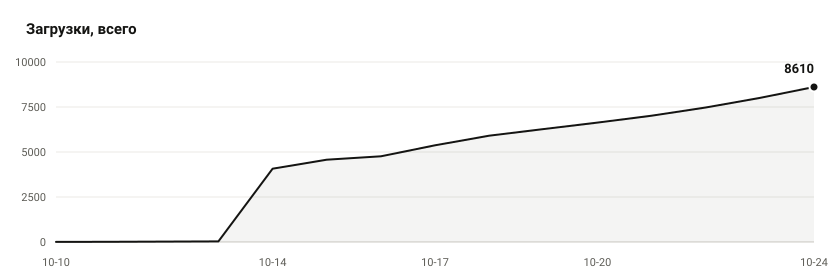

# Umbrella Scripts

Сайт Lua-скриптов для Umbrella.

Сайт: https://4ujiuh.github.io/umbrella-scripts/
Репозиторий: https://github.com/4uJIuH/umbrella-scripts

<!-- scripts:ru:start -->
- [Tinker Turret Dodge](scripts/tinker_turret_dodge) — автоматический додж опасных способностей турелями Тинкера
- [Tinker Auto Farm](scripts/tinker_auto_farm) — автоматический фарм на Тинкере
- [Auto Shackleshot](scripts/auto_shackleshot) — автоматическое применение Shackleshot за Windranger
- [Auto Spark](scripts/auto_spark) — автоматическое использование спарков на линии
- [Rune Destruction](scripts/rune_destruction) — отправка подконтрольных юнитов к рунам
- [Earth Spirit Kick Combo](scripts/earth_spirit_kick_combo) — автоматическое Blink-комбо на Earth Spirit
- [HP/Mana 67 Ping](scripts/hp_mana_67_ping) — сообщения при достижении значений HP и маны, оканчивающихся на 67
- [Spirit Bear Pull](scripts/spirit_bear_pull) — автоматический отвод крипов медведем Lone Druid
- [Dorman Combo Assistant](scripts/dorman_combo_assistant) — комбо-ассистент для Dorman в Deadlock
- [Rem Assistant](scripts/rem_assistant) — ассистент способностей и лечения для Rem в Deadlock
- [Souls Vault / Rem's Tunnel ESP](scripts/vault_tunnel_esp) — ESP для Souls Vault и Rem's Tunnel с таймером возрождения
- [qLocalization](scripts/q_localizer) — вспомогательная библиотека для локализации Lua-интерфейсов
- [Script Manager](scripts/script_manager) — каталог скриптов Umbrella с установкой и обновлениями
- [Dynamic Island](scripts/dynamic_island_dota) — интерактивный островок с уведомлениями, таймерами и показателями матча
- [Tinker Smart Escape](scripts/tinker_smart_escape) — побег Тинкера к курсору по одной клавише
- [Lane Pull](scripts/lane_pull) — выпул вражеской волны крипом с Доминатора
- [DS Spot Block](scripts/ds_spot_block) — блок спота Вакуумом за Dark Seer
- [Custom Background](scripts/custom_background) — свои картинки на фоне меню
- [Auto Stack](scripts/auto_stack) — автостак кемпов за Кунку и Инвокера
- [Draft Helper](scripts/draft_helper) — подсказки на драфте и сборка предметов
- [MusicUI](scripts/musicui) — оверлей плеера: трек, обложка, эквалайзер, текст
- [Umbrella Lua Developer Skill](scripts/umbrella_lua) — Навык разработчика для создания Lua-скриптов Umbrella
- [Custom Stats](scripts/custom_stats) — настраиваемая панель статистики матча вместо панели Dota Plus
- [Bloodrage AutoCast](scripts/bloodrage_autocast) — автоприменение Bloodrage у Bloodseeker по переключаемому бинду
- [Naga PT Abuse](scripts/naga_pt_abuse) — переключение Power Treads при Mirror Image и Manta
- [Auto Aegis Mover](scripts/auto_aegis_mover) — возвращает важные предметы из рюкзака после гибели с Эгидой
- [Anti-Rubick](scripts/anti_rubick) — защита выбранных способностей от кражи Рубиком
- [Arc Warden Blocker](scripts/arc_warden_blocker) — перехватывает хук Пуджа и перекат Earth Spirit копией Arc Warden
- [Invoker Combo Switcher](scripts/invoker_combo_switcher) — переключает пресеты комбо Инвокера двумя клавишами
- [Magnus Skewer Ally](scripts/magnus_skewer_ally) — направляет Skewer в выбранного союзника во встроенном комбо
- [Better Better Techies Combo](scripts/better_better_techies_combo) — комбо на Techies с двумя режимами и автоматическим отходом
- [Chat Translator](scripts/chat_translator) — автоматически переводит игровой чат между английским и русским
- [Hero Grid](scripts/hero_grid) — загружает пользовательские сетки героев из JSON
- [Weather](scripts/weather) — меняет визуальную погоду на карте
- [Visage Familiar TP Helper](scripts/visage_familiar_tp) — синхронно отводит гаргулий Визажа и запускает Recall
- [Grimstroke Helper](scripts/grimstroke_helper) — подбирает цели для Ink Swell и управляет Dark Portrait
- [Phoenix SmartNova](scripts/phoenix_smartnova) — автоматизирует Fire Spirits и спасительную Supernova
- [BehaviorScoreHelper](scripts/behavior_score_helper) — повышает порядочность: авто GG, авто репорт и авто лайк
- [Отмазки](scripts/excuses) — готовые отмазки после смерти — с отправкой в чат
- [Некрологи](scripts/creep_obituary) — имена и некрологи для крипов
- [Wrapped](scripts/wrapped) — карточка итогов матча, ачивки и челленджи
- [Arc Warden's Heist](scripts/arc_warden_heist) — сценарий с Arc Warden и Tempest Double
- [Chen's Circus](scripts/chen_circus) — строи и фигуры для подконтрольных Chen юнитов
- [Mana Void Killer](scripts/mana_void_killer) — расчёт летального Mana Void за Anti-Mage
- [Lualingo](scripts/lualingo) — ежедневные уроки Lua и API Umbrella
- [Disable Tracker](scripts/disable_tracker) — считает время под разными эффектами контроля
- [Russian Roulette](scripts/russian_roulette) — игровая рулетка с выбором пуль
- [MoM Swapper](scripts/mom_swapper) — автоматически или вручную меняет MoM на Echo Sabre или Specialist's Array
- [Botle Abuse](scripts/botle) — автоматизирует перестановку предметов перед использованием Bottle
- [Action Recorder](scripts/action_recorder) — записывает и воспроизводит действия игрока
- [Io Overcharge](scripts/io_overcharge) — жмёт Overcharge, когда связанный союзник использует ультимейт
- [Arc Warden Utilities](scripts/arc_warden_utilities) — набор утилит для Arc Warden и Tempest Double
- [Back Cast](scripts/backwards_cast) — кастует направленные способности без разворота героя
- [Forge Spirit Farm (Beta)](scripts/forge_spirit_farm_beta) — бета-автофарм и стаки на Forge Spirits
- [Selection Camera](scripts/selection_camera) — переносит камеру к выбранному юниту или группе
- [Spirit Breaker Combo & Ghoul 1000-7](scripts/spirit_breaker_bara) — комбо для Spirit Breaker с предметами и чат-отсчётом
- [1000-7 Counter](scripts/ghoul_counter) — отправляет арифметический отсчёт в чат по бинду
- [Invoker Jarvis](scripts/invoker_jarvis) — голосовой помощник для Invoker
- [TikTok](scripts/umbrella_tiktok) — встроенный просмотрщик TikTok
- [Invoker AutoStack](scripts/invoker_autostack) — автоматически стакает кемпы Tornado за Invoker
- [Old Last Match](scripts/old_last_match) — возвращает старый экран последнего матча в главное меню
- [Achievements](scripts/achievements) — достижения и прогресс по истории матчей и событиям игры
- [Unusual Secret](scripts/unusual_secret) — позволяет применять эффекты к разным частям модели героя
- [Atmospheric Fog Restorer](scripts/atmospheric_fog) — возвращает атмосферный туман в игре
- [Windranger Powershot Killsteal](scripts/windranger_powershot) — автоматически добивает врагов Powershot, когда урона достаточно
- [MoM Sabre Abuse](scripts/mom_sabre_abuse) — автоматизирует ручной или автоматический абуз MoM и Sabre
- [Tinker 1x6 Farm](scripts/tinker_1x6_farm) — автофарм кемпов и волн крипов с подбором сфер
- [Forge Spirit Helper](scripts/forge_spirit_helper) — автоматически вызывает форжей и помогает пережить опасные ситуации
- [Gank Threat](scripts/gank_threat) — оценивает угрозу ганка и время подхода врагов
- [Tinker Helper](scripts/tinker_helper) — набор функций для фарма и автоматизации на Тинкере
- [Counter Items](scripts/counter_items) — подсказывает контр-предметы против героев и их покупок
- [Old HUD](scripts/old_hud) — возвращает старый вариант HUD до аспектов
- [Illusion Tracker](scripts/illusion_tracker) — отслеживает иллюзии и показывает назначенные им бинды
- [Arc Warden Clone Safe Me](scripts/arc_warden_clone_safe_me) — командует клону Arc Warden спасать настоящего героя
- [Arc Warden Multi Stack](scripts/arc_warden_multi_stack) — автоматически стакует несколько лагерей на Arc Warden
- [Map Chat Troll](scripts/maptroll) — рисует текст на миникарте вручную или по таймеру
- [Creep Aggro](scripts/creep_aggro) — помогает переагривать крипов клавишей и подконтрольными юнитами
- [Nyx Assassin Auto Burrow](scripts/nyx_auto_burrow) — автоматически закапывает Nyx Assassin в подходящий момент
- [Dawnbreaker Solar Guardian Auto-Save Helper](scripts/dawnbreaker_solar_guardian) — автоматизирует Solar Guardian для сейва и контринициации
- [Dota 1x6 Pack](scripts/dota1x6_pack) — собирает комбо для Dota 1x6 в одном Lua-файле
- [Kez Raptor Dance Dispel](scripts/kez_raptor_dispel) — использует Kazurai Katana для частого диспела через Raptor Dance
- [Huskar Life Break](scripts/huskar_life_break) — прерывает полёт Life Break, сохраняя попадание ульты
- [Dragon Camp Pull](scripts/dragon_camp_pull) — отправляет пачки с линии в лес к приручённому дракону
- [Shadow Demon Poison 5](scripts/sd_poison_5) — автоматически подрывает Shadow Poison при пяти и более стаках
- [Techies Auto Miner](scripts/techies_auto_miner) — автоматически минирует выбранные зоны карты на Techies
- [Broodmother Camp Blocker](scripts/brood_camp_blocker) — отправляет пауков Брудмазер блокировать спавн кемпов
- [Hoodwink Blast Off Catch](scripts/hoodwink_bushwhack_techies) — ловит Techies способностью Bushwhack во время Blast Off
- [Render Inspector](scripts/render_inspector) — веб-инструмент для исследования отрисованных элементов
- [Ringmaster Eul Combo](scripts/ringmaster_eul_combo) — комбо Ринмастера через Eul, кнут и колесо
- [Spirit Breaker Charge Combo](scripts/spirit_breaker_charge) — автоматические предметы и ускорения во время Charge of Darkness
- [Ward Predictor](scripts/ward_predictor) — прогнозирует места установки вардов вражескими саппортами
- [Invoker SS](scripts/invoker_ss) — отдельный модуль Sun Strike с prediction и ручным наведением
- [Sentry](scripts/sentry) — экспериментальный анализ поведения и угроз на карте
- [Changer](scripts/changer) — экспериментальный скрипт визуальных эффектов героя
- [Self Play](scripts/self_play_bot) — автоматически управляет героем и выполняет игровые задачи
- [Farm Pattern 2.5](scripts/farm_pattern) — строит и визуализирует маршруты фарма
- [Win Condition Engine](scripts/win_condition_engine) — подсказывает приоритетные действия по ситуации на карте
- [Invoker (beta)](scripts/invoker_beta) — переработанный скрипт Invoker с динамическим прокастом
- [Kez Combo](scripts/kez_combo) — комбо-скрипт Kez, сделанный для личного использования
- [Techies Combo](scripts/techies_combo) — комбо Techies с режимами агрессии и максимального урона
- [Lone Druid Auto Farm](scripts/ld_farm) — отправляет Lone Druid безопасно фармить лес, пока вы управляете медведем
- [Unusual Effects](scripts/unusual_cosmetics) — меняет необычные эффекты предметов
- [Techies Tazer Dispel](scripts/techies_tazer_dispel) — автоматически снимает некоторые эффекты Reactive Tazer
- [SteamSync](scripts/steam_sync) — переносит конфиги Dota 2 между Steam-аккаунтами
- [Techies Brain Combo](scripts/techies_brain) — комбо Techies от Hex до детонации мин
- [Creep Control](scripts/creep_control) — управляет подконтрольными существами для фарма и пуша
- [KOTL Illuminate Pro](scripts/kotl_illuminate_pro) — рассчитывает летальный урон Illuminate и отпускает луч вовремя
- [Lycan Auto Control](scripts/lycan_auto_control) — отправляет волков пушить, а подконтрольных юнитов — фармить лес
- [Mute Voice Lines](scripts/mute_voice_lines) — приглушает выбранные фразы из колеса чата
- [Tinker Glimmer during Rearm](scripts/tinker_glimmer_rearm) — использует Glimmer Cape во время Rearm
- [Dota No Limit](scripts/dota_no_limit) — добавляет выбор и автоматическое использование предметов для поедания
- [Team Maphack](scripts/team_maphack) — отмечает события игры в чате и на миникарте
- [Last Seen Trajectory](scripts/lastseen_trajectory) — показывает последнее направление движения врага
- [KOTL Auto Chakra](scripts/kotl_auto_chakra) — дополнительные автоматизации для Keeper of the Light
- [SF Feast of Souls Abuse](scripts/sf_feast_of_souls_abuse) — автоматизирует взаимодействие Feast of Souls с предметами и эффектами
- [Block Creep Attack During Feast](scripts/sf_block_creep_attack) — блокирует атаки по крипам во время Feast of Souls
- [Anti-Cyclone BKB](scripts/sf_anti_cyclone_bkb) — пытается использовать BKB перед вражеским циклоном
- [Control Ally](scripts/control_ally) — комбо для союзного героя под совместным управлением
- [Eul / Wind Waker Blink Helper](scripts/eul_wind_waker_blink_helper) — визуальные подсказки для Blink после Eul или Wind Waker
- [Dark Carnival Path Tokens](scripts/dark_carnival_path_tokens) — показывает нужные токены и героев для Dark Carnival
- [Lone Druid Bear AI Deluxe](scripts/lone_druid_bear_ai_deluxe) — автоматически управляет медведем Lone Druid
- [Lina Hero Brain](scripts/lina_hero_brain) — мозг Lina в дополнение к встроенному скрипту UCZone
- [Sniper Hero Brain](scripts/sniper_hero_brain) — дополнительный мозг для Sniper на UCZone
- [Ward Triangulator](scripts/ward_triangulator) — находит вражеские сентри по наблюдениям и триангуляции
- [Muerta Dead Shot](scripts/muerta_dead_shot) — подбирает траекторию Dead Shot с рикошетами и страхом к Muerta
- [Enemy Cooldowns](scripts/enemy_cooldowns) — показывает перезарядку способностей и предметов врагов
- [Can Teleport Out](scripts/can_teleport_out) — использует предметы на телепортирующемся герое
- [Auto Courier Gem](scripts/auto_courier_gem) — отправляет курьера за выпавшим Gem и возвращает его в тайник
- [Camp Stacker](scripts/stacker) — стак кемпов героями, иллюзиями и подконтрольными юнитами
- [Auto-Ruin](scripts/auto_ruin) — автоматически покупает расходники и выполняет действия у фонтана
- [Broodmother Helper](scripts/broodmother_helper) — автоконтроль, преследование и фарм пауков Broodmother
- [Script Market](scripts/market) — устанавливает, удаляет и обновляет скрипты из ScriptIvMarket
- [MMR Tracker Ultimate](scripts/mmr_tracker_ultimate) — панель ранга, прогресса MMR и статистики сессии
- [Glyph Timer](scripts/glyph_timer) — показывает таймер глифа над башнями и крипами
- [Rampage Timer](scripts/rampage_timer_h) — таймер серии убийств с панелью в стиле Liquid Glass
- [Arc Warden Control Rune](scripts/arc_warden_control_rune) — контролирует руны Арком и его клоном
- [TreeCutter+](scripts/treecutter_plus) — помогает прокладывать короткий путь через деревья
- [Tinker Fear of God Combo](scripts/tinker_fear_of_god) — комбо и побег для старой версии Тинкера
- [Arc Warden High Five](scripts/arc_warden_high_five) — автоматически отбивает «пятюню» клоном Арка
- [Creep Block](scripts/creep_block) — экспериментальный блок крипов подконтрольными юнитами
- [Ember Spirit Sticky Trainer](scripts/ember_spirit_sticky_trainer) — тренировочный комбо-скрипт с предиктом ремнантов и побегом
- [PT Mana Abuse](scripts/pt_mana_abuse) — проверяет ману при переключении Power Treads на интеллект
- [Marci Dust Delivery](scripts/marci_dust_delivery) — автоматически доставляет и использует Dust за Marci
- [Arc Warden Rune Control](scripts/arc_warden_rune_control) — контролирует руну клоном Арка Вардена
- [Cooldown Ping](scripts/cooldown_ping) — сообщает команде о кулдаунах способностей и предметов
- [Beastmaster Razorbacks](scripts/beastmaster_razorbacks) — умное управление кабанами Beastmaster
- [Juggernaut Ward Control](scripts/juggernaut_ward_control) — умно управляет Healing Ward Джаггернаута
- [Invoker Auto Alacrity](scripts/invoker_auto_alacrity) — автоматически вызывает Alacrity и применяет к выбранной цели
- [Snapfire Cookie Landing](scripts/snapfire_cookie_landing) — показывает место приземления и радиус стана Firesnap Cookie
- [Mute All Voice Phrases](scripts/mute_all_voice_phrases) — приглушает голосовые фразы, включая фразы Dota Plus
- [Mini Games](scripts/mini_games) — набор мини-игр и развлечений во вкладке Scripts
- [MMR Log](scripts/mmr_log) — ведёт журнал MMR и ежедневную статистику матчей
- [Invoker Sun Strike on TP](scripts/invoker_sunstrike_on_tp) — применяет Sun Strike на телепортящегося врага при летальном уроне
- [Авто-пик](scripts/autopick) — автоматически выбирает героя по приоритетам для каждой роли
- [TXT Spoofer](scripts/txt_spoofer) — находит и заменяет текстовые надписи в меню
- [Zeus Heavenly Jump Range](scripts/zeus_heavenly_jump_range) — показывает дальность прыжка Heavenly Jump и цели молнии
- [Meepo V2](scripts/meepo_v2) — бета-набор автоматизации и настроек для Meepo
- [Abaddon Borrowed Time+1](scripts/abaddon_borrowed_time_plus_one) — берёт ульт Abaddon, когда ожидается опасный урон
- [Змейка](scripts/zmeyka) — мини-игра «Змейка» с настраиваемыми режимами
- [Dota Imba](scripts/dota_imba) — утилита для ролла рун и выбора наград в кастомке
- [Earth Spirit Boulder Helper](scripts/earth_spirit_boulder_helper) — показывает ориентиры для попадания Rolling Boulder
- [Walrus Kick Assist](scripts/walrus_kick_assist) — ассистирует с комбо Walrus Kick, Snowball и Blink
- [Techies Reactive Tazer Auto-Detonate](scripts/techies_tazer_auto_detonate) — взрывает Reactive Tazer при опасных эффектах у врага
- [Invoker TP Sun Strike](scripts/invoker_tp_sun_strike) — наводит Sun Strike на телепорты и поддерживает ручное применение
- [Courier Build Route](scripts/courier_build_route) — отправляет курьера по маршруту к фонтану
- [Brood Pull S](scripts/brood_pull_s) — помогает Broodmother отводить крипов на линии
- [Force Cookie Cursor Cast](scripts/force_cookie_cursor_cast) — направляет Force, Pike и Firesnap Cookie к курсору
- [Abaddon AutoMistCoil](scripts/abaddon_auto_mist_coil) — автоматически лечит союзников способностью Mist Coil
- [Void Spirit Escape](scripts/void_spirit_escape) — последовательно использует способности и предметы для побега
- [PogodaUI](scripts/pogoda_ui) — показывает погоду и прогноз для выбранного города
- [Fog of War Predictor](scripts/fog_of_war_predictor) — оценивает вероятное положение врагов в тумане войны
- [Tree Cutter](scripts/tree_cutter_bf2) — автоматически рубит ближайшие деревья Quelling Blade или Battle Fury
- [Session Info](scripts/session_info) — панель MMR, статистики матчей и текущей игровой сессии
- [AutoFocus](scripts/autofocus) — переключает атаки на важные вражеские призывы и объекты
- [Warlock Control Golems](scripts/warlock_control_golems) — управляет големами Warlock после применения Chaotic Offering
- [Dust Radius](scripts/dust_radius) — показывает радиус уже применённого Dust
- [CosmicMenu](scripts/cosmic_menu) — добавляет анимированный космический фон в меню чита
- [TinkerTweak](scripts/tinker_tweak) — набор визуальных помощников и твиков для Tinker
- [FlutterFX](scripts/flutter_fx) — настраиваемые визуальные цифры урона и лечения
- [Tinker Glimmer Combo](scripts/tinker_glimmer_combo) — комбо и модуль побега для Tinker с Glimmer Cape
- [Toxic Chat Guard](scripts/toxic_chat_guard) — локально выявляет токсичные сообщения в игровом чате
- [AutoUnsleep](scripts/auto_unsleep) — будит героев из Nightmare с помощью подконтрольных юнитов
- [Follow Selected Hero](scripts/follow_selected_hero) — ассистент следования и поддержки выбранного героя
- [RadialChat](scripts/radial_chat) — колесо быстрого ввода сообщений в командный и общий чат
- [InteractiveMenu](scripts/interactive_menu) — анимированный фон и эффекты для меню Umbrella
- [MMR Tracker Ultimate](scripts/ranks_mmr_tracker) — панель MMR с целью, историей матчей и защитой от тильта
- [Lycan Auto Howl](scripts/lycan_auto_howl) — автоматически применяет Howl по условиям здоровья и урона
- [Shadow Fiend Requiem Radius](scripts/sf_requiem_radius) — визуализирует радиус Requiem of Souls
- [STRATZ Live Stats Tracker](scripts/dotaplus_tracker) — сравнивает игровые показатели героя со статистикой STRATZ
- [Illuminate Visualizer](scripts/illuminate_visualizer) — показывает направление и реальную зону Illuminate
- [Aegis Blinkout Cone](scripts/aegis_blinkout_cone) — показывает направление Blink после возрождения с Aegis
- [Nature's Call Block](scripts/natures_call_block) — помогает блокировать врагов способностью Nature's Call
- [Remote Auto Search](scripts/remote_auto_search) — запускает поиск матча удалённой командой через ntfy.sh
- [OpenDota Stats Tracker](scripts/opendota_stats_tracker) — строит статистику игры по последним матчам и данным OpenDota
- [Dark Carnival Suggest Heroes](scripts/dark_carnival_suggest_heroes) — подсказывает героев для получения жетонов Dark Carnival
- [Meepo Auto Escape](scripts/meepo_auto_escape) — автоматически отводит Meepo с низким здоровьем в безопасное место
- [Incoming Damage HUD](scripts/incoming_damage_hud) — оценивает потенциальный урон врагов по вашему герою
- [Tinker Turret Double Tap](scripts/tinker_turret_double_tap) — кастит Deploy Turrets по двойному нажатию E
- [Ntfy Match Notifier](scripts/ntfy_match_notifier) — отправляет push-уведомление при принятии матча
- [Auto Summons](scripts/auto_summons_kiting) — уводит кабанов и фордж-спиритов от атакующих врагов
- [Dazzle Auto Support](scripts/dazzle_support) — автоматически применяет защитные способности и предметы Dazzle
- [KOTL Illuminate Kill Release](scripts/kotl_illuminate_kill_release) — отпускает Illuminate, когда рассчитанного урона достаточно для убийства
- [Hero Speed Overlay](scripts/hero_speed_overlay) — показывает разницу скорости передвижения героев
- [AI Chat Responder](scripts/ai_chat_responder) — отвечает на сообщения в игровом чате через выбранную AI-модель
- [Windranger Combo](scripts/windranger_combo) — комбо и визуальные помощники для Windranger
- [Lone Druid Bear AI Deluxe](scripts/lone_druid_bear_ai_deluxe) — расширенное управление Spirit Bear для Lone Druid
- [ULTRASHIZOFRENIA Auto Laugh](scripts/ultrashizfrenia_laugh) — периодически отправляет команду игрового смеха
- [ULTRASHIZOFRENIA Auto High Five](scripts/ultrashizfrenia_high_five) — автоматически отвечает на запрос союзника дать пять
- [Rubick Last Spell](scripts/rubick_last_spell) — показывает название последнего использованного заклинания текстом
- [Invoker Combo Panel](scripts/invoker_combo_panel) — настраиваемая панель комбо для Инвокера
- [Invoker Ice Wall Farm](scripts/invoker_ice_wall_farm) — индикаторы и автокаст Ice Wall для фарма кемпов
- [Meepo Block](scripts/meepo_block) — блокирует противника клонами Мипо
- [Power Treads Strength on Low HP](scripts/pt_strength_low_hp) — переключает Power Treads на силу при низком здоровье
- [Combine Lock Click](scripts/combine_lock_click) — снимает блокировку объединения предмета по клику
- [Invoker Ice Wall on Cursor](scripts/invoker_ice_wall_cursor) — направляет Ice Wall в точку курсора
- [Chaos Knight Crit Guard (Experimental)](scripts/chaos_knight_crit_guard) — экспериментальная отмена атак без критического удара
- [Witch Doctor Ward Controller](scripts/witch_doctor_ward_controller) — автоматически направляет Death Ward на героя с низким здоровьем
- [Sense Metrics](scripts/sense_metrics) — настраиваемый watermark с ping, FPS и временем
- [Terrorblade Conjure Spam](scripts/terrorblade_conjure_spam) — использует иллюзии Terrorblade для дополнительного фарма
- [Invoker Alacrity Allies Panel](scripts/invoker_alacrity_allies_panel) — выбирает союзников для перенаправления Alacrity
- [HTML Widget](scripts/html_widget) — отображает пользовательские HTML-виджеты в Umbrella
- [Synoptic Forecast](scripts/synoptic_forecast) — шутливый прогноз погоды по текущей обстановке на линиях
- [Pedometer](scripts/pedometer) — считает шаги, расстояние и калории героя
- [Sunbeam](scripts/luchik) — ревнивый смайлик-компаньон, который реагирует на события матча
- [Deny Taunt](scripts/deny_taunt) — шуточные сообщения противнику после деная крипа
- [PudgeHook AI](scripts/pudge_hook_ai) — автоматический Meat Hook по врагам и спасение союзников
- [Arc Warden Wave Pusher](scripts/arc_warden_wave_pusher) — умный пуш крип-волн клоном Arc Warden
- [Echo BKB Dodge](scripts/echo_bkb_dodge) — автоматически нажимает BKB при блинке вражеского Earthshaker
- [Force Staffer](scripts/force_staffer) — разворачивает Force Staff и Hurricane Pike по курсору
- [AntiPause Helper](scripts/anti_pause_helper) — помогает снять паузу в игре
- [Shadow Shaman Ward Controller](scripts/shadow_shaman_ward_controller) — автоматически приказывает вардaм Shadow Shaman атаковать выбранные цели
- [Force Staff Direction](scripts/force_staff_direction) — показывает направление отталкивания Force Staff и Hurricane Pike
- [Terrorblade Sunder + Dagon](scripts/terrorblade_sunder_dagon) — комбо Terrorblade с Sunder, Ethereal Blade и Dagon
- [Venomancer Ward Controller](scripts/venomancer_ward_controller) — автоматически направляет Plague Wards на Healing Ward и героев
- [Cloud Radar](scripts/web_radar) — живой радар матча для друзей по ссылке
- [Murzik Kitty Widget](scripts/murzik) — котик-компаньон в углу экрана
- [Трекер привычек](scripts/habits) — ежедневные и игровые привычки прямо в Dota 2
- [Калории](scripts/calories) — шуточный дневник питания героя
- [Календарь](scripts/calendar) — календарь событий с напоминаниями поверх Dota 2
- [Arc Warden Clone Pike](scripts/arc_warden_clone_pike) — пика от клона для спасения Арк Вардена
- [PT Mana Abuse (ctx)](scripts/pt_mana_abuse_ctx) — автоматически переключает Power Treads на интеллект для каста
<!-- scripts:ru:end -->

На странице скрипта есть описание, установка, история версий и загрузка.

## Установка

Tinker Turret Dodge: скачай `tinker_turret_dodge.lua` и `!_qLocalizer.lua` в `umbrella\scripts`,
перезагрузи Lua-скрипты и открой `General → Tinker Turret Dodge`.

Tinker Auto Farm: скачай и распакуй `Tinker-Auto-Farm.zip`, помести `Tinker.lua` и папку `lib`
в `umbrella\scripts`, перезагрузи Lua-скрипты и открой `Scripts → Scripts → Tinker`.

Auto Shackleshot: скачай `Auto_Shackleshot.lua` и `!_qLocalizer.lua` в `umbrella\scripts`,
перезагрузи Lua-скрипты и открой `Скрипты → Скрипты → Auto Shackleshot`.

Auto Spark: скачай `Auto_Spark.lua` и `!_qLocalizer.lua` в `umbrella\scripts`,
перезагрузи Lua-скрипты и открой `Скрипты → Скрипты → Auto Spark`.

Rune Destruction: скачай `rune_units.lua` в `umbrella\scripts`, перезагрузи Lua-скрипты
и открой `Scripts → Rune Units`.

Earth Spirit Kick Combo: скачай `earth_spirit_kick_combo.lua` и `!_qLocalizer.lua` в
`umbrella\scripts`, перезагрузи Lua-скрипты и открой `General → Earth Spirit Kick Combo`.

HP/Mana 67 Ping: скачай `hp_mana_67_ping.lua` и `!_qLocalizer.lua` в `umbrella\scripts`,
перезагрузи Lua-скрипты и открой `General → HP/Mana 67 Ping → Settings`.

Spirit Bear Pull: скачай `lone_druid_bear_pull.lua` и `!_qLocalizer.lua` в `umbrella\scripts`,
перезагрузи Lua-скрипты и открой `General → Spirit Bear Pull`.

Dorman Combo Assistant: скачай `Dorman.lua` и `!_qLocalizer.lua` в `%cheat_dir%/deadlock_scripts`,
перезагрузи Lua-скрипты и открой `Heroes → Hero List → The Dorman → Dorman`.

Rem Assistant: скачай `Rem_Assistant.lua` и `!_qLocalizer.lua` в `%cheat_dir%/deadlock_scripts`,
перезагрузи Lua-скрипты и открой `Heroes → Hero List → Rem → Rem Assistant`.

Souls Vault / Rem's Tunnel ESP: скачай `VaultTunnelESP.lua` в папку скриптов Deadlock,
перезагрузи Lua-скрипты и открой `Visuals → World → Show Me More → Vault & Tunnel ESP`.

qLocalization: [скачай `_qLocalizer.lua`](https://github.com/4uJIuH/umbrella-scripts/releases/download/q-localizer-v1.0.0/_qLocalizer.lua),
переименуй файл в `!_qLocalizer.lua` и положи рядом со скриптами, которым нужна локализация.
Это сторонняя библиотека автора qfun (qfun_g9s), не мой скрипт.

---

# English

Lua scripts for Umbrella.

Site: https://4ujiuh.github.io/umbrella-scripts/
Repository: https://github.com/4uJIuH/umbrella-scripts

<!-- scripts:en:start -->
- [Tinker Turret Dodge](scripts/tinker_turret_dodge) — automatically dodges dangerous abilities with Tinker turrets
- [Tinker Auto Farm](scripts/tinker_auto_farm) — automatic farming on Tinker
- [Auto Shackleshot](scripts/auto_shackleshot) — automatic Shackleshot on Windranger
- [Auto Spark](scripts/auto_spark) — automatic Spark Wraith usage on the lane
- [Rune Destruction](scripts/rune_destruction) — send controlled units to runes
- [Earth Spirit Kick Combo](scripts/earth_spirit_kick_combo) — automatic Blink combo on Earth Spirit
- [HP/Mana 67 Ping](scripts/hp_mana_67_ping) — chat messages when HP or mana reaches a value ending in 67
- [Spirit Bear Pull](scripts/spirit_bear_pull) — automatically pull a creep wave with Lone Druid's bear
- [Dorman Combo Assistant](scripts/dorman_combo_assistant) — a combo assistant for Dorman in Deadlock
- [Rem Assistant](scripts/rem_assistant) — ability and healing assistant for Rem in Deadlock
- [Souls Vault / Rem's Tunnel ESP](scripts/vault_tunnel_esp) — ESP for Souls Vault and Rem's Tunnel with respawn timers
- [qLocalization](scripts/q_localizer) — a helper library for localizing Lua interfaces
- [Script Manager](scripts/script_manager) — an Umbrella script catalog with script installation and updates
- [Dynamic Island](scripts/dynamic_island_dota) — an interactive island for match stats, alerts, and timers
- [Tinker Smart Escape](scripts/tinker_smart_escape) — escape towards the cursor with a single key
- [Lane Pull](scripts/lane_pull) — pull the enemy wave with your Dominator creep
- [DS Spot Block](scripts/ds_spot_block) — Vacuum spot block for Dark Seer
- [Custom Background](scripts/custom_background) — your own pictures behind the menu
- [Auto Stack](scripts/auto_stack) — camp stacking for Kunkka and Invoker
- [Draft Helper](scripts/draft_helper) — draft hints and item builds
- [MusicUI](scripts/musicui) — player overlay: track, cover, equalizer, lyrics
- [Umbrella Lua Developer Skill](scripts/umbrella_lua) — Developer skill for creating Umbrella Lua scripts
- [Custom Stats](scripts/custom_stats) — a customizable match-stats panel to replace Dota Plus stats
- [Bloodrage AutoCast](scripts/bloodrage_autocast) — toggle-bind auto-cast for Bloodseeker's Bloodrage
- [Naga PT Abuse](scripts/naga_pt_abuse) — Power Treads switching for Mirror Image and Manta
- [Auto Aegis Mover](scripts/auto_aegis_mover) — moves a priority item from the backpack after dying with Aegis
- [Anti-Rubick](scripts/anti_rubick) — protect selected spells from Rubick's Spell Steal
- [Arc Warden Blocker](scripts/arc_warden_blocker) — uses Arc Warden's clone to intercept Pudge hooks and Earth Spirit rolls
- [Invoker Combo Switcher](scripts/invoker_combo_switcher) — switches Invoker combo presets with two hotkeys
- [Magnus Skewer Ally](scripts/magnus_skewer_ally) — redirects the built-in Magnus combo's Skewer towards an ally
- [Better Better Techies Combo](scripts/better_better_techies_combo) — a Techies combo with two modes and an automatic disengage
- [Chat Translator](scripts/chat_translator) — automatically translates in-game chat between English and Russian
- [Hero Grid](scripts/hero_grid) — loads custom hero grids from JSON files
- [Weather](scripts/weather) — changes the visual map weather
- [Visage Familiar TP Helper](scripts/visage_familiar_tp) — synchronizes Familiar Recall and retreats Visage's familiars
- [Grimstroke Helper](scripts/grimstroke_helper) — selects Ink Swell targets and controls Dark Portrait
- [Phoenix SmartNova](scripts/phoenix_smartnova) — automates Fire Spirits and emergency Supernova
- [BehaviorScoreHelper](scripts/behavior_score_helper) — raises your behavior score: auto GG, auto report, and auto like
- [Отмазки](scripts/excuses) — ready-made excuses after a death, with chat sending
- [Некрологи](scripts/creep_obituary) — names and obituaries for creeps
- [Wrapped](scripts/wrapped) — match summary cards, achievements, and challenges
- [Arc Warden's Heist](scripts/arc_warden_heist) — an Arc Warden and Tempest Double sequence
- [Chen's Circus](scripts/chen_circus) — formations and patterns for Chen's controlled units
- [Mana Void Killer](scripts/mana_void_killer) — calculates lethal Mana Void casts for Anti-Mage
- [Lualingo](scripts/lualingo) — daily lessons in Lua and the Umbrella API
- [Disable Tracker](scripts/disable_tracker) — tracks time spent under disabling effects
- [Russian Roulette](scripts/russian_roulette) — a game of roulette with configurable bullets
- [MoM Swapper](scripts/mom_swapper) — swaps MoM with Echo Sabre or Specialist's Array
- [Botle Abuse](scripts/botle) — automates item rearrangement before using Bottle
- [Action Recorder](scripts/action_recorder) — records and replays player actions
- [Io Overcharge](scripts/io_overcharge) — casts Overcharge when the tethered ally uses an ultimate
- [Arc Warden Utilities](scripts/arc_warden_utilities) — a set of utilities for Arc Warden and Tempest Double
- [Back Cast](scripts/backwards_cast) — casts directional abilities without turning the hero
- [Forge Spirit Farm (Beta)](scripts/forge_spirit_farm_beta) — beta Forge Spirit farming and camp stacking
- [Selection Camera](scripts/selection_camera) — moves the camera to the selected unit or group
- [Spirit Breaker Combo & Ghoul 1000-7](scripts/spirit_breaker_bara) — Spirit Breaker combo with items and a chat countdown
- [1000-7 Counter](scripts/ghoul_counter) — sends a chat arithmetic countdown with a bind
- [Invoker Jarvis](scripts/invoker_jarvis) — voice assistant for Invoker
- [TikTok](scripts/umbrella_tiktok) — an embedded TikTok viewer
- [Invoker AutoStack](scripts/invoker_autostack) — automatically stacks camps with Invoker's Tornado
- [Old Last Match](scripts/old_last_match) — restores the old last-match screen in the main menu
- [Achievements](scripts/achievements) — achievements and progress from match history and live game events
- [Unusual Secret](scripts/unusual_secret) — attaches selected effects to different parts of a hero model
- [Atmospheric Fog Restorer](scripts/atmospheric_fog) — restores atmospheric fog in the game
- [Windranger Powershot Killsteal](scripts/windranger_powershot) — automatically kill secures with Powershot when its damage is lethal
- [MoM Sabre Abuse](scripts/mom_sabre_abuse) — automates manual or automatic Mask of Madness and Echo Sabre abuse
- [Tinker 1x6 Farm](scripts/tinker_1x6_farm) — farms camps and creep waves while collecting upgrade orbs
- [Forge Spirit Helper](scripts/forge_spirit_helper) — automatically summons Forge Spirits and reacts to selected threats
- [Gank Threat](scripts/gank_threat) — estimates gank danger and enemy arrival times
- [Tinker Helper](scripts/tinker_helper) — a collection of farming and automation features for Tinker
- [Counter Items](scripts/counter_items) — recommends counter-items against enemy heroes and their purchases
- [Old HUD](scripts/old_hud) — restores a pre-aspect version of the HUD
- [Illusion Tracker](scripts/illusion_tracker) — tracks illusions and displays their assigned control groups
- [Arc Warden Clone Safe Me](scripts/arc_warden_clone_safe_me) — orders Arc Warden's clone to save the real hero
- [Arc Warden Multi Stack](scripts/arc_warden_multi_stack) — automatically stacks multiple camps with Arc Warden
- [Map Chat Troll](scripts/maptroll) — draws text on the minimap manually or on a timer
- [Creep Aggro](scripts/creep_aggro) — helps manipulate creep aggro with a key and controlled units
- [Nyx Assassin Auto Burrow](scripts/nyx_auto_burrow) — automatically burrows Nyx Assassin at suitable times
- [Dawnbreaker Solar Guardian Auto-Save Helper](scripts/dawnbreaker_solar_guardian) — automates Solar Guardian saves and counter-initiation
- [Dota 1x6 Pack](scripts/dota1x6_pack) — packs Dota 1x6 hero combos into one Lua file
- [Kez Raptor Dance Dispel](scripts/kez_raptor_dispel) — uses Kazurai Katana for repeated Raptor Dance dispels
- [Huskar Life Break](scripts/huskar_life_break) — stops Life Break travel while preserving the ultimate hit
- [Dragon Camp Pull](scripts/dragon_camp_pull) — pulls lane waves into the jungle for a controlled dragon to farm
- [Shadow Demon Poison 5](scripts/sd_poison_5) — automatically releases Shadow Poison at five or more stacks
- [Techies Auto Miner](scripts/techies_auto_miner) — automatically mines selected map zones as Techies
- [Broodmother Camp Blocker](scripts/brood_camp_blocker) — sends Broodmother's spiders to block neutral camp spawns
- [Hoodwink Blast Off Catch](scripts/hoodwink_bushwhack_techies) — catches Techies with Bushwhack during Blast Off
- [Render Inspector](scripts/render_inspector) — a web tool for inspecting rendered screen elements
- [Ringmaster Eul Combo](scripts/ringmaster_eul_combo) — Ringmaster combo with Eul, the whip, and the wheel
- [Spirit Breaker Charge Combo](scripts/spirit_breaker_charge) — automated items and speed boosts during Charge of Darkness
- [Ward Predictor](scripts/ward_predictor) — predicts where enemy supports may place wards
- [Invoker SS](scripts/invoker_ss) — standalone Sun Strike module with prediction and manual targeting
- [Sentry](scripts/sentry) — experimental analysis of enemy behavior and map threats
- [Changer](scripts/changer) — experimental visual effects changer for your hero
- [Self Play](scripts/self_play_bot) — automatically controls a hero and handles in-game objectives
- [Farm Pattern 2.5](scripts/farm_pattern) — plans and visualizes efficient farming routes
- [Win Condition Engine](scripts/win_condition_engine) — suggests priorities based on the current map situation
- [Invoker (beta)](scripts/invoker_beta) — reworked Invoker script with dynamic spell combos
- [Kez Combo](scripts/kez_combo) — Kez combo script built for personal use
- [Techies Combo](scripts/techies_combo) — Techies combo with aggressive and maximum-damage modes
- [Lone Druid Auto Farm](scripts/ld_farm) — farms the jungle with Lone Druid while you control the bear
- [Unusual Effects](scripts/unusual_cosmetics) — changes unusual item effects
- [Techies Tazer Dispel](scripts/techies_tazer_dispel) — automatically dispels selected effects with Reactive Tazer
- [SteamSync](scripts/steam_sync) — transfers Dota 2 configuration between Steam accounts
- [Techies Brain Combo](scripts/techies_brain) — Techies combo from Hex through mine detonation
- [Creep Control](scripts/creep_control) — controls summoned and dominated units for farming and pushing
- [KOTL Illuminate Pro](scripts/kotl_illuminate_pro) — calculates lethal Illuminate damage and releases the beam at the right time
- [Lycan Auto Control](scripts/lycan_auto_control) — sends wolves to push and dominated units to farm the jungle
- [Mute Voice Lines](scripts/mute_voice_lines) — mutes selected chat-wheel voice lines
- [Tinker Glimmer during Rearm](scripts/tinker_glimmer_rearm) — uses Glimmer Cape during Rearm
- [Dota No Limit](scripts/dota_no_limit) — adds selection and automatic use of supported consumable items
- [Team Maphack](scripts/team_maphack) — marks game events in chat and on the minimap
- [Last Seen Trajectory](scripts/lastseen_trajectory) — shows the last known direction an enemy moved
- [KOTL Auto Chakra](scripts/kotl_auto_chakra) — additional Keeper of the Light automation
- [SF Feast of Souls Abuse](scripts/sf_feast_of_souls_abuse) — automates Feast of Souls interactions with items and effects
- [Block Creep Attack During Feast](scripts/sf_block_creep_attack) — blocks creep attacks during Feast of Souls
- [Anti-Cyclone BKB](scripts/sf_anti_cyclone_bkb) — attempts to use BKB before an enemy cyclone
- [Control Ally](scripts/control_ally) — combo control for a shared-control allied hero
- [Eul / Wind Waker Blink Helper](scripts/eul_wind_waker_blink_helper) — visual Blink cues after Eul or Wind Waker
- [Dark Carnival Path Tokens](scripts/dark_carnival_path_tokens) — shows the tokens and heroes needed for Dark Carnival
- [Lone Druid Bear AI Deluxe](scripts/lone_druid_bear_ai_deluxe) — automatically controls Lone Druid's bear
- [Lina Hero Brain](scripts/lina_hero_brain) — a Lina decision-making companion for UCZone's built-in script
- [Sniper Hero Brain](scripts/sniper_hero_brain) — an additional Sniper brain for UCZone
- [Ward Triangulator](scripts/ward_triangulator) — locates enemy sentries through visibility observations and triangulation
- [Muerta Dead Shot](scripts/muerta_dead_shot) — plans Dead Shot ricochets and fears targets toward Muerta
- [Enemy Cooldowns](scripts/enemy_cooldowns) — shows enemy ability and item cooldowns
- [Can Teleport Out](scripts/can_teleport_out) — uses items on a hero while they are teleporting
- [Auto Courier Gem](scripts/auto_courier_gem) — sends the courier to pick up a dropped Gem and return it to stash
- [Camp Stacker](scripts/stacker) — stacks camps with heroes, illusions, and controlled units
- [Auto-Ruin](scripts/auto_ruin) — automates consumable purchases and actions near the fountain
- [Broodmother Helper](scripts/broodmother_helper) — Broodmother spider control, chasing, and farming
- [Script Market](scripts/market) — installs, removes, and updates scripts from ScriptIvMarket
- [MMR Tracker Ultimate](scripts/mmr_tracker_ultimate) — rank, MMR progress, and session-statistics panel
- [Glyph Timer](scripts/glyph_timer) — shows glyph timers above towers and creeps
- [Rampage Timer](scripts/rampage_timer_h) — a kill-streak timer with a Liquid Glass-style panel
- [Arc Warden Control Rune](scripts/arc_warden_control_rune) — controls runes with Arc Warden and his clone
- [TreeCutter+](scripts/treecutter_plus) — helps cut a shortcut through trees
- [Tinker Fear of God Combo](scripts/tinker_fear_of_god) — combo and escape script for the older Tinker
- [Arc Warden High Five](scripts/arc_warden_high_five) — automatically returns High Fives with Arc Warden's clone
- [Creep Block](scripts/creep_block) — experimental creep blocking with controllable units
- [Ember Spirit Sticky Trainer](scripts/ember_spirit_sticky_trainer) — a training combo script with Remnant prediction and escape
- [PT Mana Abuse](scripts/pt_mana_abuse) — checks mana after switching Power Treads to Intelligence
- [Marci Dust Delivery](scripts/marci_dust_delivery) — automatically delivers and uses Dust as Marci
- [Arc Warden Rune Control](scripts/arc_warden_rune_control) — controls a rune with an Arc Warden clone
- [Cooldown Ping](scripts/cooldown_ping) — notifies the team about ability and item cooldowns
- [Beastmaster Razorbacks](scripts/beastmaster_razorbacks) — smart Beastmaster boar control
- [Juggernaut Ward Control](scripts/juggernaut_ward_control) — smart Juggernaut Healing Ward control
- [Invoker Auto Alacrity](scripts/invoker_auto_alacrity) — automatically invokes Alacrity and casts it on a selected target
- [Snapfire Cookie Landing](scripts/snapfire_cookie_landing) — shows the Firesnap Cookie landing point and stun radius
- [Mute All Voice Phrases](scripts/mute_all_voice_phrases) — mutes voice phrases, including Dota Plus lines
- [Mini Games](scripts/mini_games) — a collection of mini-games and diversions under Scripts
- [MMR Log](scripts/mmr_log) — tracks MMR changes and daily match statistics
- [Invoker Sun Strike on TP](scripts/invoker_sunstrike_on_tp) — casts Sun Strike on teleporting enemies when it is lethal
- [Авто-пик](scripts/autopick) — automatically picks a hero using role-specific priorities
- [TXT Spoofer](scripts/txt_spoofer) — finds and replaces text labels in the menu
- [Zeus Heavenly Jump Range](scripts/zeus_heavenly_jump_range) — shows Heavenly Jump distance and lightning targets
- [Meepo V2](scripts/meepo_v2) — a beta automation and settings suite for Meepo
- [Abaddon Borrowed Time+1](scripts/abaddon_borrowed_time_plus_one) — learns Abaddon's ultimate when dangerous damage is predicted
- [Змейка](scripts/zmeyka) — a Snake mini-game with configurable modes
- [Dota Imba](scripts/dota_imba) — a utility for rerolling runes and selecting custom-game rewards
- [Earth Spirit Boulder Helper](scripts/earth_spirit_boulder_helper) — shows aiming markers for Rolling Boulder
- [Walrus Kick Assist](scripts/walrus_kick_assist) — assists with Walrus Kick, Snowball, and Blink combos
- [Techies Reactive Tazer Auto-Detonate](scripts/techies_tazer_auto_detonate) — detonates Reactive Tazer when enemies have selected effects
- [Invoker TP Sun Strike](scripts/invoker_tp_sun_strike) — aims Sun Strike at teleporting enemies and supports manual casts
- [Courier Build Route](scripts/courier_build_route) — sends your courier along a route toward the fountain
- [Brood Pull S](scripts/brood_pull_s) — helps Broodmother pull lane creeps
- [Force Cookie Cursor Cast](scripts/force_cookie_cursor_cast) — aims Force, Pike, and Firesnap Cookie toward the cursor
- [Abaddon AutoMistCoil](scripts/abaddon_auto_mist_coil) — automatically heals allies with Mist Coil
- [Void Spirit Escape](scripts/void_spirit_escape) — sequences abilities and items to escape danger
- [PogodaUI](scripts/pogoda_ui) — shows current weather and forecast for a selected city
- [Fog of War Predictor](scripts/fog_of_war_predictor) — estimates where enemies may be in the fog of war
- [Tree Cutter](scripts/tree_cutter_bf2) — automatically chops nearby trees with Quelling Blade or Battle Fury
- [Session Info](scripts/session_info) — an MMR, match-statistics, and current-session panel
- [AutoFocus](scripts/autofocus) — focuses attacks on high-value enemy summons and objects
- [Warlock Control Golems](scripts/warlock_control_golems) — controls Warlock's golems after Chaotic Offering
- [Dust Radius](scripts/dust_radius) — shows the radius of Dust that has already been used
- [CosmicMenu](scripts/cosmic_menu) — adds an animated cosmic backdrop to the cheat menu
- [TinkerTweak](scripts/tinker_tweak) — visual helpers and tweaks for Tinker
- [FlutterFX](scripts/flutter_fx) — customizable floating damage and healing numbers
- [Tinker Glimmer Combo](scripts/tinker_glimmer_combo) — a Tinker combo and escape module with Glimmer Cape
- [Toxic Chat Guard](scripts/toxic_chat_guard) — locally detects toxic messages in in-game chat
- [AutoUnsleep](scripts/auto_unsleep) — wakes heroes from Nightmare using controllable units
- [Follow Selected Hero](scripts/follow_selected_hero) — follow and support assistant for a selected hero
- [RadialChat](scripts/radial_chat) — radial message wheel for team and all chat
- [InteractiveMenu](scripts/interactive_menu) — animated backdrop and effects for the Umbrella menu
- [MMR Tracker Ultimate](scripts/ranks_mmr_tracker) — MMR panel with a custom goal, match history, and tilt guard
- [Lycan Auto Howl](scripts/lycan_auto_howl) — automatically casts Howl based on health and damage conditions
- [Shadow Fiend Requiem Radius](scripts/sf_requiem_radius) — visualizes the Requiem of Souls radius
- [STRATZ Live Stats Tracker](scripts/dotaplus_tracker) — compares live hero performance with STRATZ statistics
- [Illuminate Visualizer](scripts/illuminate_visualizer) — visualizes Illuminate direction and effective hit area
- [Aegis Blinkout Cone](scripts/aegis_blinkout_cone) — shows a Blink direction cone after an Aegis respawn
- [Nature's Call Block](scripts/natures_call_block) — helps block enemies with Nature's Call
- [Remote Auto Search](scripts/remote_auto_search) — starts matchmaking from a remote ntfy.sh command
- [OpenDota Stats Tracker](scripts/opendota_stats_tracker) — builds performance statistics from recent matches and OpenDota
- [Dark Carnival Suggest Heroes](scripts/dark_carnival_suggest_heroes) — suggests heroes that grant the Dark Carnival tokens you need
- [Meepo Auto Escape](scripts/meepo_auto_escape) — automatically sends low-health Meepos to safety
- [Incoming Damage HUD](scripts/incoming_damage_hud) — estimates potential enemy damage against your hero
- [Tinker Turret Double Tap](scripts/tinker_turret_double_tap) — casts Deploy Turrets on a double press of E
- [Ntfy Match Notifier](scripts/ntfy_match_notifier) — sends a push notification when a match is accepted
- [Auto Summons](scripts/auto_summons_kiting) — kites Beastmaster boars and Invoker Forge Spirits away from attackers
- [Dazzle Auto Support](scripts/dazzle_support) — automatically casts Dazzle's defensive spells and items
- [KOTL Illuminate Kill Release](scripts/kotl_illuminate_kill_release) — releases Illuminate when its estimated damage can kill
- [Hero Speed Overlay](scripts/hero_speed_overlay) — shows the movement-speed difference between heroes
- [AI Chat Responder](scripts/ai_chat_responder) — replies to in-game chat using a selected AI model
- [Windranger Combo](scripts/windranger_combo) — combo and visual helpers for Windranger
- [Lone Druid Bear AI Deluxe](scripts/lone_druid_bear_ai_deluxe) — advanced Spirit Bear control for Lone Druid
- [ULTRASHIZOFRENIA Auto Laugh](scripts/ultrashizfrenia_laugh) — periodically sends the in-game laugh command
- [ULTRASHIZOFRENIA Auto High Five](scripts/ultrashizfrenia_high_five) — automatically responds to a nearby ally's high-five request
- [Rubick Last Spell](scripts/rubick_last_spell) — shows the most recently used spell as text
- [Invoker Combo Panel](scripts/invoker_combo_panel) — a configurable combo panel for Invoker
- [Invoker Ice Wall Farm](scripts/invoker_ice_wall_farm) — Ice Wall indicators and auto-cast for camp farming
- [Meepo Block](scripts/meepo_block) — blocks an enemy with Meepo clones
- [Power Treads Strength on Low HP](scripts/pt_strength_low_hp) — switches Power Treads to Strength at low health
- [Combine Lock Click](scripts/combine_lock_click) — unlocks an item on click
- [Invoker Ice Wall on Cursor](scripts/invoker_ice_wall_cursor) — aims Invoker Ice Wall at the cursor
- [Chaos Knight Crit Guard (Experimental)](scripts/chaos_knight_crit_guard) — experimental cancellation of attacks without a critical hit
- [Witch Doctor Ward Controller](scripts/witch_doctor_ward_controller) — automatically targets the lowest-health hero with Death Ward
- [Sense Metrics](scripts/sense_metrics) — a configurable watermark with ping, FPS, and time
- [Terrorblade Conjure Spam](scripts/terrorblade_conjure_spam) — uses Terrorblade illusions for additional farming
- [Invoker Alacrity Allies Panel](scripts/invoker_alacrity_allies_panel) — selects allies to receive redirected Alacrity casts
- [HTML Widget](scripts/html_widget) — displays custom HTML widgets in Umbrella
- [Synoptic Forecast](scripts/synoptic_forecast) — a playful weather forecast based on current lane activity
- [Pedometer](scripts/pedometer) — tracks your hero’s steps, distance, and calories
- [Sunbeam](scripts/luchik) — a jealous emoji companion reacting to match events
- [Deny Taunt](scripts/deny_taunt) — playful chat lines after denying a creep
- [PudgeHook AI](scripts/pudge_hook_ai) — automated Meat Hook targeting and ally saves
- [Arc Warden Wave Pusher](scripts/arc_warden_wave_pusher) — smart creep-wave pushing with Arc Warden's clone
- [Echo BKB Dodge](scripts/echo_bkb_dodge) — automatically uses BKB when an enemy Earthshaker Blinks nearby
- [Force Staffer](scripts/force_staffer) — turns Force Staff and Hurricane Pike toward the cursor
- [AntiPause Helper](scripts/anti_pause_helper) — helps resume a paused game
- [Shadow Shaman Ward Controller](scripts/shadow_shaman_ward_controller) — automatically orders Shadow Shaman wards to attack selected targets
- [Force Staff Direction](scripts/force_staff_direction) — shows Force Staff and Hurricane Pike push directions
- [Terrorblade Sunder + Dagon](scripts/terrorblade_sunder_dagon) — Terrorblade combo with Sunder, Ethereal Blade, and Dagon
- [Venomancer Ward Controller](scripts/venomancer_ward_controller) — automatically targets Healing Ward and heroes with Plague Wards
- [Cloud Radar](scripts/web_radar) — live match radar for friends via a link
- [Murzik Kitty Widget](scripts/murzik) — a little cat companion in the corner of the screen
- [Трекер привычек](scripts/habits) — daily and in-game habit tracking in Dota 2
- [Калории](scripts/calories) — a tongue-in-cheek food diary for your hero
- [Календарь](scripts/calendar) — an event calendar with reminders over Dota 2
- [Arc Warden Clone Pike](scripts/arc_warden_clone_pike) — use the clone's Pike to save Arc Warden
- [PT Mana Abuse (ctx)](scripts/pt_mana_abuse_ctx) — switches Power Treads to Intelligence when needed to cast
<!-- scripts:en:end -->

The script page includes its description, installation steps, version history, and download.

## Install

Tinker Turret Dodge: download `tinker_turret_dodge.lua` and `!_qLocalizer.lua` into
`umbrella\scripts`, reload the Lua scripts, and open `General → Tinker Turret Dodge`.

Tinker Auto Farm: download and extract `Tinker-Auto-Farm.zip`, place `Tinker.lua` and the `lib`
folder in `umbrella\scripts`, reload the Lua scripts, and open `Scripts → Scripts → Tinker`.

Auto Shackleshot: download `Auto_Shackleshot.lua` and `!_qLocalizer.lua` into
`umbrella\scripts`, reload the Lua scripts, and open `Scripts → Scripts → Auto Shackleshot`.

Auto Spark: download `Auto_Spark.lua` and `!_qLocalizer.lua` into `umbrella\scripts`,
reload the Lua scripts, and open `Scripts → Scripts → Auto Spark`.

Rune Destruction: download `rune_units.lua` into `umbrella\scripts`, reload the Lua scripts,
and open `Scripts → Rune Units`.

Earth Spirit Kick Combo: download `earth_spirit_kick_combo.lua` and `!_qLocalizer.lua` into
`umbrella\scripts`, reload the Lua scripts, and open `General → Earth Spirit Kick Combo`.

HP/Mana 67 Ping: download `hp_mana_67_ping.lua` and `!_qLocalizer.lua` into
`umbrella\scripts`, reload the Lua scripts, and open `General → HP/Mana 67 Ping → Settings`.

Spirit Bear Pull: download `lone_druid_bear_pull.lua` and `!_qLocalizer.lua` into
`umbrella\scripts`, reload the Lua scripts, and open `General → Spirit Bear Pull`.

Dorman Combo Assistant: download `Dorman.lua` and `!_qLocalizer.lua` into
`%cheat_dir%/deadlock_scripts`, reload the Lua scripts, and open `Heroes → Hero List → The Dorman → Dorman`.

Rem Assistant: download `Rem_Assistant.lua` and `!_qLocalizer.lua` into
`%cheat_dir%/deadlock_scripts`, reload the Lua scripts, and open `Heroes → Hero List → Rem → Rem Assistant`.

Souls Vault / Rem's Tunnel ESP: download `VaultTunnelESP.lua` into your Deadlock scripts folder,
reload the Lua scripts, and open `Visuals → World → Show Me More → Vault & Tunnel ESP`.

qLocalization: [download `_qLocalizer.lua`](https://github.com/4uJIuH/umbrella-scripts/releases/download/q-localizer-v1.0.0/_qLocalizer.lua),
rename it to `!_qLocalizer.lua`, and place it alongside scripts that require localization.
This third-party library is by qfun (qfun_g9s), not my script.

## Downloads

<!-- stats:start -->
| script | downloads | latest |
| --- | --- | --- |
| [Tinker Turret Dodge](scripts/tinker_turret_dodge) | 35 | `tinker-turret-dodge-v1.1.5` |
| [Tinker Auto Farm](scripts/tinker_auto_farm) | 13 | `tinker-auto-farm-v1.0.4` |
| [Auto Shackleshot](scripts/auto_shackleshot) | 16 | `auto-shackleshot-v1.0.0` |
| [Auto Spark](scripts/auto_spark) | 19 | `auto-spark-v1.0.0` |
| [Rune Destruction](scripts/rune_destruction) | 20 | `rune-destruction-v1.0.2` |
| [Earth Spirit Kick Combo](scripts/earth_spirit_kick_combo) | 15 | `earth-spirit-kick-combo-v1.0.0` |
| [HP/Mana 67 Ping](scripts/hp_mana_67_ping) | 8 | `hp-mana-67-ping-v1.0.1` |
| [Spirit Bear Pull](scripts/spirit_bear_pull) | 16 | `spirit-bear-pull-v1.0.0` |
| [Dorman Combo Assistant](scripts/dorman_combo_assistant) | 1 | `dorman-combo-assistant-v1.0.0` |
| [Rem Assistant](scripts/rem_assistant) | 2 | `rem-assistant-v1.0.0` |
| [Souls Vault / Rem's Tunnel ESP](scripts/vault_tunnel_esp) | 1 | `vault-tunnel-esp-v1.0.0` |
| [qLocalization](scripts/q_localizer) | 103 | `q-localizer-v1.0.0` |
| [Script Manager](scripts/script_manager) | 382 | `script-manager-v2.14.2` |
| [Dynamic Island](scripts/dynamic_island_dota) | 633 | `v2.5.3` |
| [Tinker Smart Escape](scripts/tinker_smart_escape) | 10 | `tinker-smart-escape-v1.0.0` |
| [Lane Pull](scripts/lane_pull) | 270 | `lane-pull-v1.0.4` |
| [DS Spot Block](scripts/ds_spot_block) | 57 | `ds-spot-block-v1.0.1` |
| [Custom Background](scripts/custom_background) | 49 | `custom-background-v1.0.0` |
| [Auto Stack](scripts/auto_stack) | 158 | `auto-stack-v1.1.0` |
| [Draft Helper](scripts/draft_helper) | 1459 | `draft-helper-v2.0.0-beta.20` |
| [MusicUI](scripts/musicui) | 727 | `musicui-v1.0.8` |
| [Umbrella Lua Developer Skill](scripts/umbrella_lua) | 204 | `umbrella-lua-v1.0.4` |
| [Custom Stats](scripts/custom_stats) | 14 | `custom-stats-v1.0.0` |
| [Bloodrage AutoCast](scripts/bloodrage_autocast) | 8 | `bloodrage-autocast-v1.0.0` |
| [Naga PT Abuse](scripts/naga_pt_abuse) | 13 | `naga-pt-abuse-v1.0.0` |
| [Auto Aegis Mover](scripts/auto_aegis_mover) | 21 | `auto-aegis-mover-v1.0.0` |
| [Anti-Rubick](scripts/anti_rubick) | 17 | `anti-rubick-v1.0.0` |
| [Arc Warden Blocker](scripts/arc_warden_blocker) | 11 | `arc-warden-blocker-v1.0.0` |
| [Invoker Combo Switcher](scripts/invoker_combo_switcher) | 12 | `invoker-combo-switcher-v1.0.0` |
| [Magnus Skewer Ally](scripts/magnus_skewer_ally) | 12 | `magnus-skewer-ally-v1.0.0` |
| [Better Better Techies Combo](scripts/better_better_techies_combo) | 33 | `better-better-techies-combo-v1.0.0` |
| [Chat Translator](scripts/chat_translator) | 17 | `chat-translator-v1.0.0` |
| [Hero Grid](scripts/hero_grid) | 1 | `hero-grid-v1.0.0` |
| [Weather](scripts/weather) | 12 | `weather-v1.0.0` |
| [Visage Familiar TP Helper](scripts/visage_familiar_tp) | 10 | `visage-familiar-tp-v1.0.0` |
| [Grimstroke Helper](scripts/grimstroke_helper) | 10 | `grimstroke-helper-v1.0.0` |
| [Phoenix SmartNova](scripts/phoenix_smartnova) | 9 | `phoenix-smartnova-v1.0.0` |
| [BehaviorScoreHelper](scripts/behavior_score_helper) | 16 | `behavior-score-helper-v1.1.1` |
| [Disable Tracker](scripts/disable_tracker) | 4 | `disable-tracker-v1.0.0` |
| [Russian Roulette](scripts/russian_roulette) | 2 | `russian-roulette-v1.0.0` |
| [MoM Swapper](scripts/mom_swapper) | 9 | `mom-swapper-v1.0.0` |
| [Botle Abuse](scripts/botle) | 19 | `botle-abuse-v1.0.0` |
| [Action Recorder](scripts/action_recorder) | 4 | `action-recorder-v1.0.0` |
| [Io Overcharge](scripts/io_overcharge) | 10 | `io-overcharge-v1.0.0` |
| [Arc Warden Utilities](scripts/arc_warden_utilities) | 21 | `arc-warden-utilities-v1.1.0` |
| [Back Cast](scripts/backwards_cast) | 24 | `backwards-cast-v1.0.0` |
| [Forge Spirit Farm (Beta)](scripts/forge_spirit_farm_beta) | 6 | `forge-spirit-farm-beta-v0.1.0-beta.1` |
| [Selection Camera](scripts/selection_camera) | 5 | `selection-camera-v1.1.0` |
| [Spirit Breaker Combo & Ghoul 1000-7](scripts/spirit_breaker_bara) | 5 | `spirit-breaker-bara-v1.0.0` |
| [1000-7 Counter](scripts/ghoul_counter) | 9 | `ghoul-counter-v1.0.0` |
| [Invoker Jarvis](scripts/invoker_jarvis) | 43 | `v1.3.1` |
| [TikTok](scripts/umbrella_tiktok) | 303 | `v1.3.2` |
| [Invoker AutoStack](scripts/invoker_autostack) | 78 | `v1.4.2` |
| [Old Last Match](scripts/old_last_match) | 14 | `old-last-match-v1.0.0` |
| [Unusual Secret](scripts/unusual_secret) | 13 | `unusual-secret-v2.1.0` |
| [Atmospheric Fog Restorer](scripts/atmospheric_fog) | 6 | `atmospheric-fog-v1.0.0` |
| [Windranger Powershot Killsteal](scripts/windranger_powershot) | 16 | `windranger-powershot-v1.0.0` |
| [MoM Sabre Abuse](scripts/mom_sabre_abuse) | 6 | `mom-sabre-abuse-v2.0.0` |
| [Tinker 1x6 Farm](scripts/tinker_1x6_farm) | 4 | `tinker-1x6-farm-v1.0.0` |
| [Forge Spirit Helper](scripts/forge_spirit_helper) | 18 | `forge-spirit-helper-v1.0.0` |
| [Gank Threat](scripts/gank_threat) | 14 | `gank-threat-v1.0.0` |
| [Tinker Helper](scripts/tinker_helper) | 13 | `tinker-helper-v1.0.0` |
| [Old HUD](scripts/old_hud) | 4 | `old-hud-v1.0.0` |
| [Illusion Tracker](scripts/illusion_tracker) | 3 | `illusion-tracker-v1.0.0` |
| [Arc Warden Clone Safe Me](scripts/arc_warden_clone_safe_me) | 5 | `arc-warden-clone-safe-me-v1.0.0` |
| [Arc Warden Multi Stack](scripts/arc_warden_multi_stack) | 5 | `arc-warden-multi-stack-v1.0.0` |
| [Map Chat Troll](scripts/maptroll) | 10 | `maptroll-v1.0.0` |
| [Creep Aggro](scripts/creep_aggro) | 16 | `creep-aggro-v1.0.0` |
| [Nyx Assassin Auto Burrow](scripts/nyx_auto_burrow) | 4 | `nyx-auto-burrow-v1.0.0` |
| [Dawnbreaker Solar Guardian Auto-Save Helper](scripts/dawnbreaker_solar_guardian) | 11 | `dawnbreaker-solar-guardian-v1.0.0` |
| [Dota 1x6 Pack](scripts/dota1x6_pack) | 30 | `dota-1x6-pack-v1.0.0` |
| [Kez Raptor Dance Dispel](scripts/kez_raptor_dispel) | 8 | `kez-raptor-dispel-v1.0.0` |
| [Huskar Life Break](scripts/huskar_life_break) | 6 | `huskar-life-break-v1.0.0` |
| [Dragon Camp Pull](scripts/dragon_camp_pull) | 0 | `dragon-camp-pull-v1.0` |
| [Shadow Demon Poison 5](scripts/sd_poison_5) | 5 | `sd-poison-5-v1.0.0` |
| [Techies Auto Miner](scripts/techies_auto_miner) | 0 | `techies-auto-miner-v1.1` |
| [Broodmother Camp Blocker](scripts/brood_camp_blocker) | 0 | `brood-camp-blocker-v1.6` |
| [Hoodwink Blast Off Catch](scripts/hoodwink_bushwhack_techies) | 6 | `hoodwink-bushwhack-techies-v1.0.0` |
| [Ringmaster Eul Combo](scripts/ringmaster_eul_combo) | 7 | `ringmaster-eul-combo-v1.0.0` |
| [Spirit Breaker Charge Combo](scripts/spirit_breaker_charge) | 14 | `spirit-breaker-charge-v1.0.0` |
| [Ward Predictor](scripts/ward_predictor) | 19 | `ward-predictor-v1.0.0` |
| [Invoker SS](scripts/invoker_ss) | 1 | `invoker-ss-v138` |
| [Sentry](scripts/sentry) | 11 | `sentry-v1.0.0` |
| [Changer](scripts/changer) | 9 | `changer-v1.0.0` |
| [Self Play](scripts/self_play_bot) | 6 | `self-play-v1.0.1` |
| [Farm Pattern 2.5](scripts/farm_pattern) | 4 | `farm-pattern-v2.5` |
| [Win Condition Engine](scripts/win_condition_engine) | 41 | `win-condition-engine-v1.0.0` |
| [Invoker (beta)](scripts/invoker_beta) | 35 | `invoker-beta-v1.0.0` |
| [Kez Combo](scripts/kez_combo) | 11 | `kez-combo-v1.0.0` |
| [Techies Combo](scripts/techies_combo) | 15 | `techies-combo-v1.0.0` |
| [Lone Druid Auto Farm](scripts/ld_farm) | 0 | `ld-farm-v1.7` |
| [Unusual Effects](scripts/unusual_cosmetics) | 5 | `unusual-cosmetics-v1.0.0` |
| [Techies Tazer Dispel](scripts/techies_tazer_dispel) | 6 | `techies-tazer-dispel-v1.0.0` |
| [SteamSync](scripts/steam_sync) | 203 | `v1.0.1` |
| [Techies Brain Combo](scripts/techies_brain) | 4 | `techies-brain-v0.2.6` |
| [Creep Control](scripts/creep_control) | 14 | `creep-control-v1.0.1` |
| [KOTL Illuminate Pro](scripts/kotl_illuminate_pro) | 25 | `kotl-illuminate-pro-v1.0.0` |
| [Lycan Auto Control](scripts/lycan_auto_control) | 10 | `lycan-auto-control-v1.0.0` |
| [Mute Voice Lines](scripts/mute_voice_lines) | 2 | `mute-voice-lines-v1.0.0` |
| [Tinker Glimmer during Rearm](scripts/tinker_glimmer_rearm) | 0 | `tinker-glimmer-rearm-v1.3` |
| [Dota No Limit](scripts/dota_no_limit) | 4 | `dota-no-limit-v1.0.0` |
| [Team Maphack](scripts/team_maphack) | 5 | `team-maphack-v1.0.0` |
| [Last Seen Trajectory](scripts/lastseen_trajectory) | 11 | `lastseen-trajectory-v1.0.0` |
| [KOTL Auto Chakra](scripts/kotl_auto_chakra) | 10 | `kotl-auto-chakra-v1.0.0` |
| [SF Feast of Souls Abuse](scripts/sf_feast_of_souls_abuse) | 1 | `sf-feast-of-souls-v4.0` |
| [Block Creep Attack During Feast](scripts/sf_block_creep_attack) | 0 | `sf-block-creep-attack-v1.2` |
| [Anti-Cyclone BKB](scripts/sf_anti_cyclone_bkb) | 0 | `sf-anti-cyclone-bkb-v2.0` |
| [Control Ally](scripts/control_ally) | 8 | `control-ally-v1.0.0` |
| [Eul / Wind Waker Blink Helper](scripts/eul_wind_waker_blink_helper) | 6 | `eul-wind-waker-blink-helper-v1.0.0` |
| [Dark Carnival Path Tokens](scripts/dark_carnival_path_tokens) | 4 | `dark-carnival-path-tokens-v1.0.0` |
| [Lone Druid Bear AI Deluxe](scripts/lone_druid_bear_ai_deluxe) | 16 | `lone-druid-bear-ai-deluxe-v1.0.0` |
| [Lina Hero Brain](scripts/lina_hero_brain) | 48 | `v0.5.173` |
| [Sniper Hero Brain](scripts/sniper_hero_brain) | 179 | `v6.15.277` |
| [Ward Triangulator](scripts/ward_triangulator) | 14 | `ward-triangulator-v1.0.0` |
| [Muerta Dead Shot](scripts/muerta_dead_shot) | 6 | `muerta-dead-shot-v1.0.0` |
| [Enemy Cooldowns](scripts/enemy_cooldowns) | 3 | `enemy-cooldowns-v1.0.0` |
| [Can Teleport Out](scripts/can_teleport_out) | 6 | `can-teleport-out-v1.0.0` |
| [Auto Courier Gem](scripts/auto_courier_gem) | 14 | `auto-courier-gem-v1.0.0` |
| [Camp Stacker](scripts/stacker) | 22 | `camp-stacker-v1.0.0` |
| [Auto-Ruin](scripts/auto_ruin) | 2 | `auto-ruin-v1.0.0` |
| [Broodmother Helper](scripts/broodmother_helper) | 0 | `broodmother-helper-v2.1` |
| [Script Market](scripts/market) | 21 | `market-v1.0.0` |
| [MMR Tracker Ultimate](scripts/mmr_tracker_ultimate) | 12 | `mmr-tracker-ultimate-v1.0.0` |
| [Glyph Timer](scripts/glyph_timer) | 35 | `glyph-timer-v1.0.0` |
| [Rampage Timer](scripts/rampage_timer_h) | 0 | `rampage-timer-h-v1.0.0` |
| [PT Mana Abuse](scripts/pt_mana_abuse) | 1 | `pt-mana-abuse-ctx-v1.0.0` |
| [Lone Druid Bear AI Deluxe](scripts/lone_druid_bear_ai_deluxe) | 16 | `lone-druid-bear-ai-deluxe-v1.0.0` |
| [PudgeHook AI](scripts/pudge_hook_ai) | 16 | `pudge-hook-ai-v1.0.0` |
| [Arc Warden Wave Pusher](scripts/arc_warden_wave_pusher) | 36 | `arc-warden-wave-pusher-v1.1.0` |
| [Echo BKB Dodge](scripts/echo_bkb_dodge) | 8 | `echo-bkb-dodge-v1.2.0` |
| [Force Staffer](scripts/force_staffer) | 5 | `force-staffer-v1.0.0` |
| [AntiPause Helper](scripts/anti_pause_helper) | 2 | `anti-pause-helper-v1.0.0` |
| [Shadow Shaman Ward Controller](scripts/shadow_shaman_ward_controller) | 2 | `shadow-shaman-ward-controller-v1.0.0` |
| [Force Staff Direction](scripts/force_staff_direction) | 3 | `force-staff-direction-v1.0.0` |
| [Terrorblade Sunder + Dagon](scripts/terrorblade_sunder_dagon) | 2 | `terrorblade-sunder-dagon-v1.0.0` |
| [Venomancer Ward Controller](scripts/venomancer_ward_controller) | 2 | `venomancer-ward-controller-v1.0.0` |
| [Cloud Radar](scripts/web_radar) | 0 | `web-radar-v2.1.0` |
| [Murzik Kitty Widget](scripts/murzik) | 1 | `murzik-v1.0.0` |
| [Трекер привычек](scripts/habits) | 1 | `habits-v1.0.0` |
| [Калории](scripts/calories) | 1 | `calories-v1.0.0` |
| [Календарь](scripts/calendar) | 1 | `calendar-v1.0.0` |
| [Arc Warden Clone Pike](scripts/arc_warden_clone_pike) | 1 | `arc-warden-clone-pike-v1.0.0` |

<picture>
  <source media="(prefers-color-scheme: dark)" srcset=".github/stats/stats-dark.svg">
  
</picture>

2026-10-19
<!-- stats:end -->
